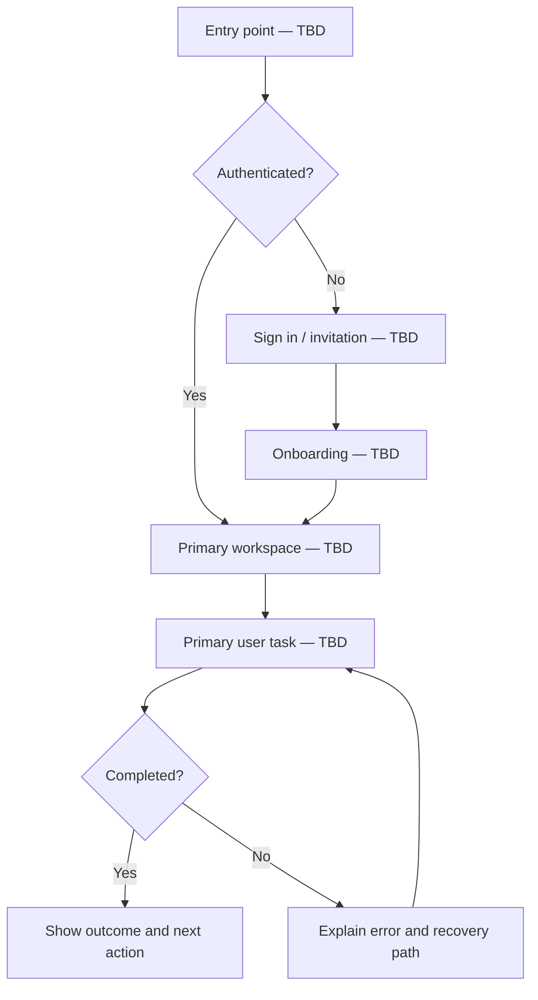

# 02 — App Flow & User Journeys

**Status:** Draft template; screens must follow validated requirements.

## 1. Entry points

- Public landing / invite / direct entry: [TBD]
- Signup or invitation requirement: [TBD]
- First-time user destination: [TBD]
- Returning user destination: [TBD]

## 2. Screen inventory

| Screen ID | Route | Purpose | Who can access | Key actions |
|---|---|---|---|---|
| SCR-001 | [TBD] | [TBD] | [TBD] | [TBD] |

Do not create screens without a user need or operational requirement.

## 3. Primary journey

1. User arrives because [TBD].
2. User understands [TBD].
3. User provides / selects [TBD].
4. System validates and processes [TBD].
5. User receives [TBD].
6. User can recover, correct, export, or exit via [TBD].

## 4. Authentication and account lifecycle

- Signup / invitation: [TBD]
- Email verification: [TBD]
- Login / logout: [TBD]
- Password reset / account recovery: [TBD]
- Session expiry: [TBD]
- Account deletion: [TBD]

## 5. States required for every data-driven screen

- Initial / loading
- Empty (with a useful next action)
- Success
- Validation error
- Permission denied
- Not found
- Network / server failure
- Expired session
- Partial failure / retry

## 6. Navigation and redirects

| Event | Expected destination / behaviour |
|---|---|
| Successful login | [TBD] |
| Successful logout | [TBD] |
| Unauthorized route | [TBD] |
| Successful primary task | [TBD] |
| User cancels a destructive action | Return without mutation |

## 7. Accessibility and usability

- All actions reachable by keyboard.
- Visible focus indicators.
- Inputs have persistent labels and understandable errors.
- Destructive actions require clear confirmation.
- Do not rely on colour alone to communicate status.
- Responsive layouts support the agreed device sizes.

## 8. Flow diagram

Replace this conceptual placeholder once the primary workflow is validated.

